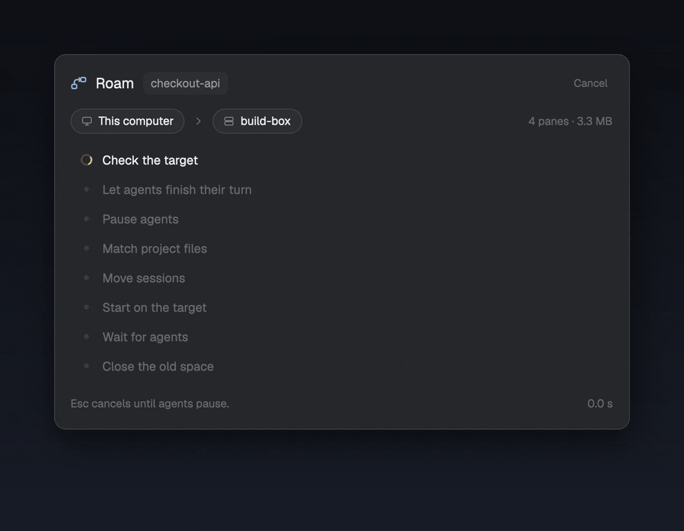
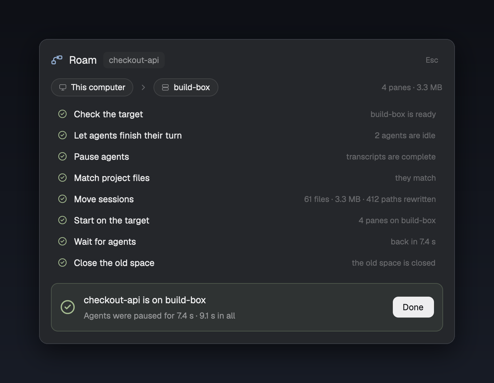
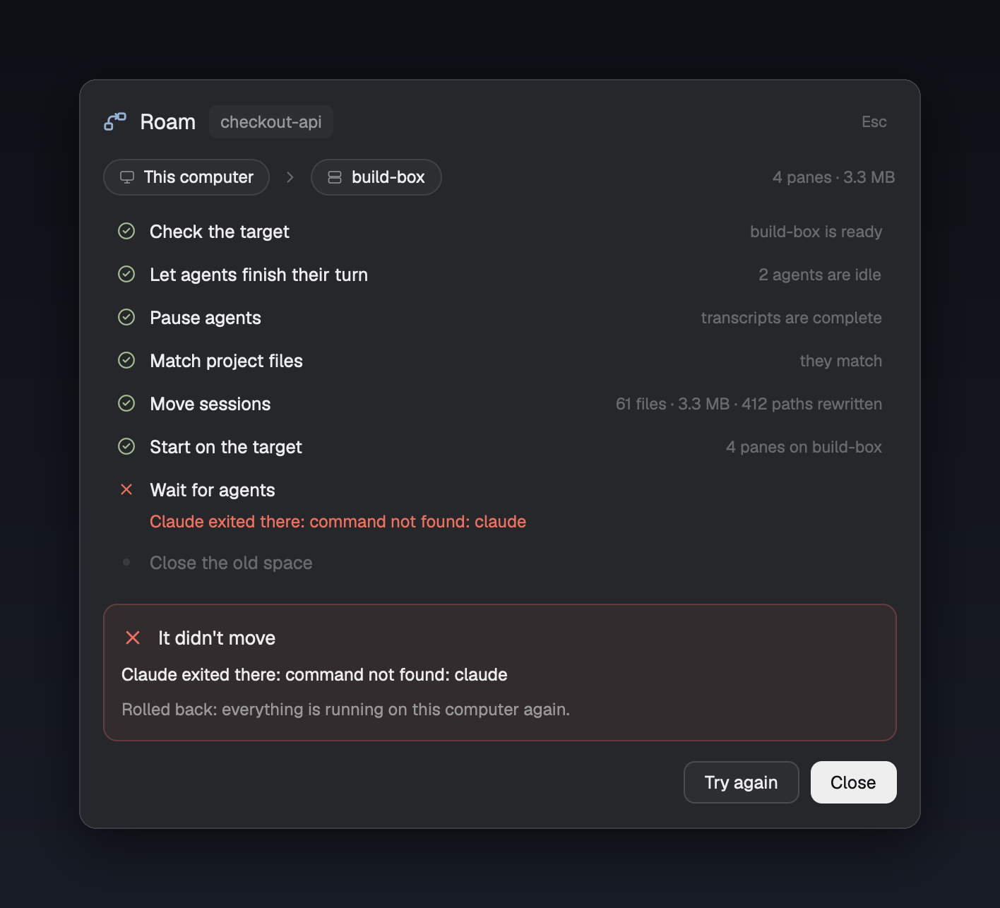
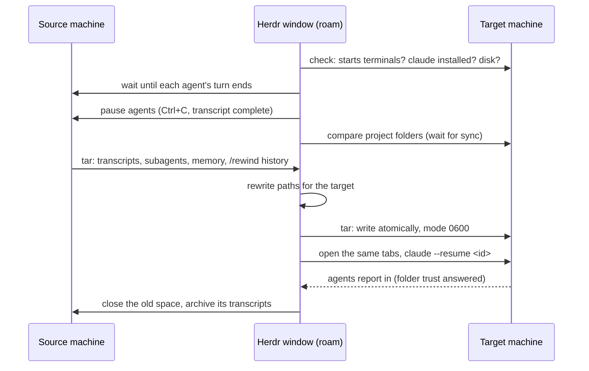

<div align="center">


# roam

**Move a live [herdr](https://herdr.dev) space, agents and all, to another machine.**

Your Claude Code sessions finish their turn, pause for a few seconds, and continue on the
other machine with their whole history. Live migration for coding agents.

[](https://github.com/bugrax/herdr-roam/actions/workflows/ci.yml)
[](https://herdr.dev/mods)
[](https://code.claude.com)
[](LICENSE)



</div>

## Why

You start a long agent run on your laptop, then need to leave. Or the Linux box is faster, or the
Mac mini at home should take over for the night. herdr already lets one window drive terminals on
all of them, but a terminal stays on the machine it started on. Closing the laptop stops the agent.

Moving a running process to another machine is what [CRIU](https://criu.org) and VM live
migration do. Neither helps here. CRIU is Linux-only and nothing like it exists for macOS. Even
between two Linux boxes, a process that holds an open TLS connection to an API and a PTY owned
by herdr-core doesn't survive the trip.

An agent's state already lives on disk, though: its transcript. So roam does live migration one
level up. It waits for each agent to finish its turn and pauses it cleanly. Then it copies the
session with every path rewritten for the new machine and resumes the agent there by id. Tabs,
panes and folders come along, and anything that fails rolls back.

| Live migration (CRIU, VMs) | roam |
|---|---|
| Pre-copy memory while it runs | Your sync (Syncthing, Dropbox, git, a shared mount) keeps project files current. roam checks they match. |
| Freeze the process | Wait for the agent's turn to end, then exit it cleanly so its transcript is complete. |
| Stop-and-copy the dirty pages | Copy the session (usually a few MB) with paths rewritten. |
| Restore on the target | The same tabs and panes, each agent started with `claude --resume <id>`. |
| Redirect traffic | The space appears under the target machine and the old one closes. |
| Roll back on failure | Agents resume where they were. |

In real moves between a MacBook and a Linux box, agents were paused for **6.5 to 8.5 seconds**.

## What you get

- **One dialog.** Press <kbd>⌘</kbd><kbd>⇧</kbd><kbd>M</kbd>, pick a machine, read what will move, press **Move**.
- **Nothing cut off.** Agents pause only between turns. Mid-turn agents finish first, and agents waiting on a prompt wait for you.
- **The whole session.** Transcripts, subagent transcripts, project memory, `/rewind` history and todo lists. After the move, `/rewind` restores files byte for byte on the new machine.
- **Any machine to any machine.** macOS and Linux, different usernames, different home folders, sessions that already moved once.
- **Paths that make sense there.** `/Users/ana/code/app` becomes `/home/ana/code/app` everywhere in the session, including Claude Code's own folder names.
- **The same layout.** Tabs keep their names and order, and the space keeps its name. Shells reopen in the same folder. A dev server's pane opens a shell that shows the command it was running.
- **A dry run first.** The review lists every pane, folder and path rule, warns about anything unusual, and blocks moves that can't work (the target can't start terminals, Claude isn't installed there, the disk is full).
- **Rollback.** If anything fails after agents pause, roam stops what it started on the target, puts back the files it wrote there, and resumes every agent where it was.
- **Zero install.** Only the mod. Nothing on any machine beyond herdr-core, `sh` and `tar`.

<p align="center">
  
  
</p>

## Install

Ask your coding agent, inside herdr:

> add the herdr mod github.com/bugrax/herdr-roam

Or by hand:

```sh
git clone https://github.com/bugrax/herdr-roam
cp -R herdr-roam/mods/roam ~/.config/herdr-app/mods/
herdr-app check ~/.config/herdr-app/mods/roam
```

Then add the shortcut from [`keys.json`](keys.json) to `~/.config/herdr-app/keys.json`, or open
roam without one:

```sh
herdr-app do mod.open --name roam
```

Install it on the computer where you use the herdr window. The other machines only need to be
connected to it (`hc machine add`) and have Claude Code installed.

## Use it

1. Open the space you want to move.
2. Press <kbd>⌘</kbd><kbd>⇧</kbd><kbd>M</kbd> and pick a machine.
3. Read the review: what moves, the folders and whether they're in sync, and the path rules.
4. Press **Move**. Keep the dialog open until it says the space is on the other machine,
   usually about ten seconds.

Moving it back works the same way, from the other machine's group in the sidebar.

## What moves, and what doesn't

| | |
|---|---|
| **Claude Code sessions** | Transcript, subagents, large tool results, project memory, `/rewind` history and todos. Resumed by id with their original flags (model, permission mode, allowed tools). Path flags are mapped. |
| **Shells** | Reopened in the same folder on the target. |
| **Other programs** (dev servers, watchers) | Stopped with the old space. The new pane opens a shell that shows the command, ready for you to run again. |
| **Project files** | Not copied when your sync already has them. roam compares the folders on both machines and waits (90 s by default) for your sync to catch up. A folder missing on the target is copied without `node_modules`, `.venv` and other rebuildable folders. |
| **Not carried over** | Background tasks an agent started, the in-memory state of MCP servers, and "allow for this session" approvals. Like after any restart, they start fresh. The first turn after a move rebuilds the prompt cache once. |

roam never copies credentials. The target must be signed in to Claude Code, and the review warns
when it's signed in to a different account than the session's.

## Settings

Optional, in `~/.config/herdr-app/roam.json`:

```json
{
  "rules": [{ "from": "/Users/ana/code", "to": "/srv/code" }],
  "syncWaitSeconds": 90,
  "carryTrust": true,
  "copyMissingProjects": true
}
```

- `rules`: your own path rules, applied before roam's. Use them when a project lives somewhere else
  on the target. Otherwise roam looks for the same path first, then the same place under the home folder.
- `syncWaitSeconds`: how long to wait for a folder that differs on the target.
- `carryTrust`: answer Claude Code's "do you trust this folder?" on the target. Claude was already
  running in that folder on the source.
- `copyMissingProjects`: copy a project folder the target doesn't have.

## Requirements

- [herdr](https://herdr.dev) with herdr-core 0.1.20 or newer, and the target added as a machine.
- Claude Code 2.1 or newer on both machines. Tested with 2.1.323 to 2.1.330.
- macOS or Linux on each machine.

## How it works

The short version is in the table above. The long version covers the steps, the path rules,
which files belong to a session, how rollback works, and the edge cases:
[docs/how-it-works.md](docs/how-it-works.md).



## Other agents

roam talks to agents through adapters. [`mods/roam/claude.js`](mods/roam/claude.js) is the first one.
Codex CLI, Gemini CLI and opencode store sessions differently but resume by id the same way.
[docs/adapters.md](docs/adapters.md) explains what an adapter does, and pull requests are welcome.

## Contributing

See [CONTRIBUTING.md](CONTRIBUTING.md). `npm test` runs the unit tests (no dependencies), and
`herdr-app do roam.preview-play` shows a made-up move in the real dialog.

## Credits

Built on [herdr](https://herdr.dev) and its mod API. The idea comes from CRIU and VM live migration.
[claude-mv](https://github.com/justinstimatze/claude-mv) mapped out where Claude Code keeps
path-dependent state.

roam is a community mod, not part of herdr or Claude Code. [MIT](LICENSE).
