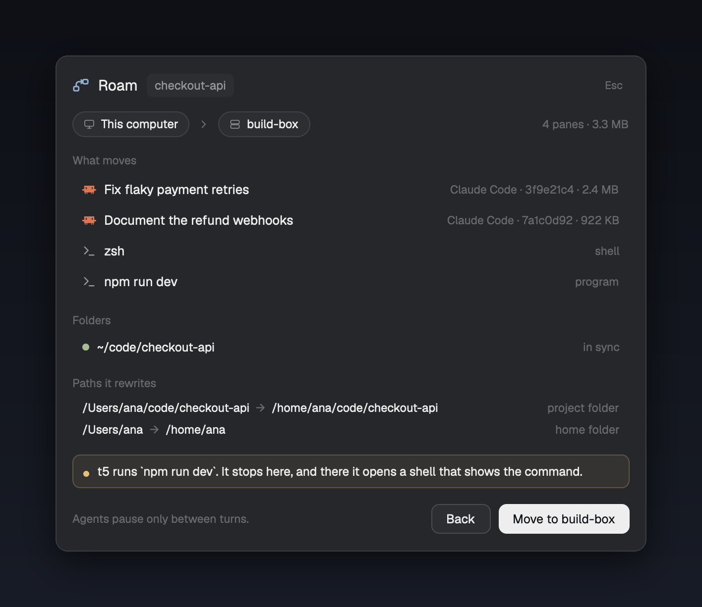

# roam

A dialog that moves the space you're looking at to another machine: its Claude Code sessions
finish their turn, pause, and continue there with their whole history, in the same tabs, while
the old space closes. If anything fails, everything resumes where it was.

## What you see

A centered modal dialog, 600 px wide, on the theme's `popover` background with 18 px padding.
Text uses the theme colors (`foreground`, `muted`, `dim`).

- **Header row:** the roam glyph (two machines joined by an arrow, `mods/roam/roam.svg`, 17 px,
  `accent`), "Roam" (15 px semibold), the space's name in a `raised` chip, and "Esc" at the right
  (11 px, `dim`). Under it, on the first screen only, one paragraph (12.8 px, `muted`) says what roam does.
- **Pick:** "Move it to" (11.5 px, `dim`), then one 40 px row per connected machine except the
  space's own. "This computer" comes first, then the others by name. Each row shows a `monitor` or
  `server` icon, the name and a chevron. The selected row uses `selected`. Offline machines are
  dimmed to 45 %.
- **Planning:** a spinner (`working`) and "Looking at the sessions, folders and <machine>…".
- **Review:**
  - A route row: two 26 px pills (source › target) and "N panes · size" at the right.
  - A scrolling area, up to 440 px:
    - *What moves:* one row per pane with the program's icon, its title, and "Claude Code ·
      <id8> · size", "shell" or "program". A second line shows `source → target` folders only
      when they differ from the folder most panes share.
    - *Folders:* a 7 px status dot (green in sync, amber waits for your sync, `working` gets
      copied), `source → target`, and the state.
    - *Paths it rewrites:* `from → to` with the rule's reason.
    - Then notes: red boxes for blockers, amber boxes for warnings.
  - A footer: a hint at the left, and **Back** and **Move to <machine>** buttons. The primary
    button uses `solid` and is at 40 % when blocked.
- **Moving:** the route row, then eight step rows: Check the target, Let agents finish their turn,
  Pause agents, Match project files, Move sessions, Start on the target, Wait for agents, Close the
  old space. Each has a 13 px mark: a pending dot, a spinning `spinner`, a green `circle-check`, a
  red `x`, or `minus` when skipped. Each has a dim detail at the right. The footer shows a hint and
  the elapsed seconds.
- **Done:** the steps, then a green-tinted card with a 22 px check, "<space> is on <machine>",
  "Agents were paused for X s · Y s in all", and **Done**.
- **Failed:** the steps (the failed one shows its error in red under it), then a red-tinted card
  ("It didn't move" or "Cancelled") with the error, "Rolled back: everything is running on
  <source> again." or "Nothing changed.", the journal path with **Copy log path**, and **Try
  again** and **Close**.

## How it behaves

- `mod.open roam` opens it for the focused space. The shipped `keys.json` binds ⌘⇧M.
- ↑/↓ (or j/k) choose a machine, Enter picks it or moves, Esc goes back or closes. While moving,
  Esc cancels until agents pause and is ignored after that.
- `roam.next`, `roam.prev`, `roam.go` and `roam.back` (`herdr-app do roam.go`) do the same from scripts.
- Agents that are `working` are waited for. Agents that are `blocked` wait for the person, and the
  step's detail says so.
- When the move finishes, a toast says so, and clicking it selects the new space. The new space is
  selected before the old one closes, which may close the dialog too.
- `roam.preview-pick|planning|review|play|done|failed` shows a made-up move (`preview.js`) for
  screenshots. It never plans or moves a real space.

## Built from

- `main.js`: the dialog (`View`). It uses `spaces()`, `machines()`, `panes()`, `focused()`,
  `theme()`, `notify()`, `closeOverlay()` and `nextCommand()`.
- `engine.js`: `plan(spaceId, machine)` makes a dry run, and `move(plan, ui)` runs the steps and
  rolls back. It calls `hc get/run/kill/label/wait/keys/send/read` and the app commands
  `space.rename`, `tab.rename`, `space.select` and `space.close`. Herdr adopts terminals started with
  `herdr.space`/`herdr.tab` labels into a new space.
- `claude.js`: the Claude Code adapter. Sessions come from `~/.claude/sessions/<pid>.json`. It pauses
  with Ctrl+C, resumes with `claude --resume`, and answers the folder-trust prompt.
- `agy.js`: the Antigravity CLI adapter. The conversation comes from the process's open files and
  moves unchanged. It resumes with `agy --conversation`.
- `paths.js`: longest-prefix path rules applied in one pass inside JSON. `claude-args.js` rebuilds
  the resume command line.
- `transport.js`: `tar` over `hc exec`, through this computer, with atomic `0600` writes and
  `.bak` files for rollback.
- `projects.js`: folder fingerprints made with `cksum` and git.
- `machine.js`: `exec`, `hc` and quoting helpers.
- It runs `sh`, `tar`, `cksum`, `find`, `git`, `df`, `kill` and `pkill` on the machines, and
  writes only under `~/.claude` and `~/.config/herdr-app/.roam`.
- Icons come from `mods/workspace-chrome/` (`server`, `monitor`, `chevron-right`, `spinner`,
  `circle-check`, `x`, `minus`, `terminal`) plus its own `roam.svg`.

## Watch out

- The move runs inside the dialog. Closing it mid-move stops the move, so `mod.json` makes the
  dialog modal, `close()` starts a rollback, and the journal (written at every step) lets the next
  dialog offer **Bring them back**.
- Never rewrite large files in the mod: QuickJS runs on Herdr's thread. `rewrite-perl.js` does it
  in a perl process.
- `hc run --json` must put `--json` before `--`, or it becomes the agent's argument.
- `hc send` wraps text for agents in `<hc>` tags, so slash commands don't work through it. Pause
  Claude with Ctrl+C instead. Text sent to a plain shell arrives as is, which rollback uses.
- The target's first Claude in a folder asks to trust it, with "No, exit" selected.
- A remote target can report an error from `hc run` and still have started the terminal. Rollback
  also runs `pkill -f "claude --resume <id>"` there.
- Herdr writes `jsconfig.json` and `*.d.ts` into the mod folder.

## Done when

- `herdr-app check ~/.config/herdr-app/mods/roam` passes, and `npm test` passes.
- A Claude Code space moves between two machines with different home folders, in both directions.
  Afterwards it answers about the earlier conversation, runs tools in the new folder, and `/rewind`
  restores a file byte for byte.
- A target that can't start terminals shows a red blocker, and Move stays disabled.
- A failure after agents pause (say, Claude isn't signed in on the target, so it exits there)
  leaves the agent running on the source with the same session, and no `.roam-*` files on the
  target.
- `herdr-app do roam.preview-play` animates all eight steps to the done card.
